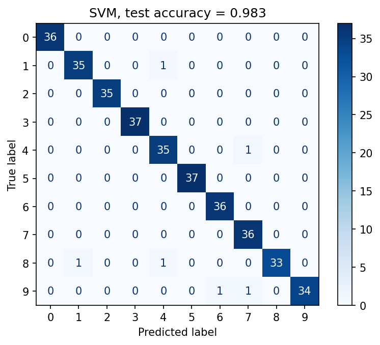

# Digits Classifier

Распознавание рукописных цифр (0–9) классическими методами машинного обучения на scikit-learn.

## Что делает

1. Загружает датасет `digits` (1797 изображений 8×8) и делит его 80/20 со стратификацией.
2. Сравнивает четыре модели 5-кратной кросс-валидацией: логистическая регрессия, k-NN, случайный лес, SVM.
3. Подбирает гиперпараметры лучшей модели (SVM) через `GridSearchCV`.
4. Оценивает итоговую модель на отложенной выборке, сохраняет метрики, матрицу ошибок и модель.
5. `predict.py` распознаёт цифру на любой картинке (PNG/JPG).

## Результаты

| Модель | Accuracy (5-fold CV) |
|---|---|
| Logistic Regression | 0.970 |
| k-NN | 0.975 |
| Random Forest | 0.976 |
| **SVM (RBF, C=50, γ=0.01)** | **0.983** |

**Точность на тестовой выборке: 98.3%** (360 изображений).



## Запуск

```bash
pip install -r requirements.txt
python train.py              # обучение, отчёт, artifacts/
python predict.py digit.png  # распознать цифру на картинке
```

`train.py` завершается с ненулевым кодом, если точность на тесте ниже 97% — встроенная проверка качества.

## Стек

Python · scikit-learn · NumPy · Matplotlib · Pillow
